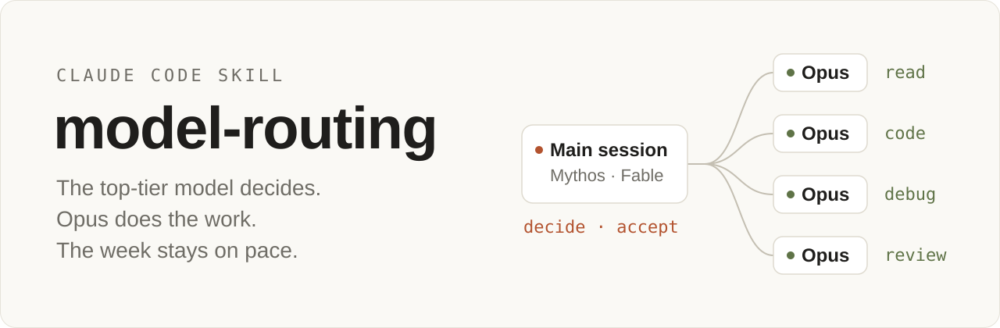
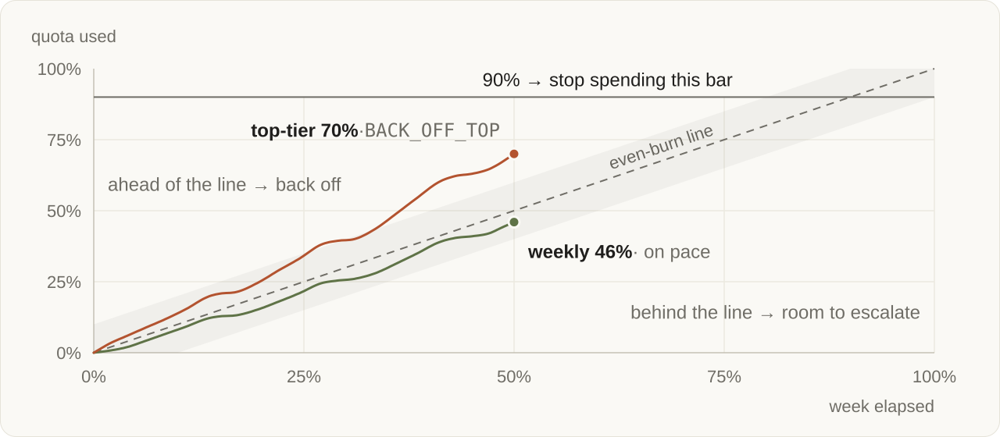
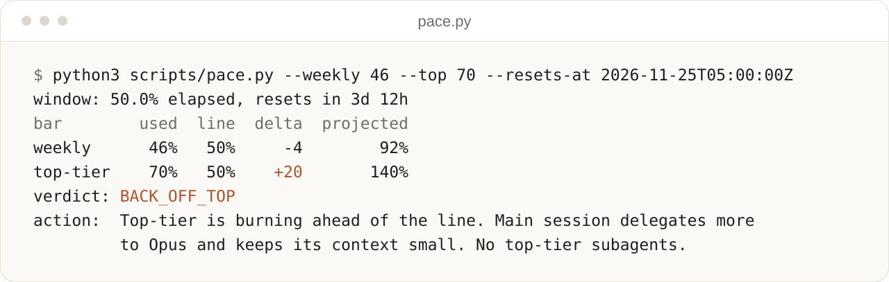

<div align="center">

<picture>
  <source media="(prefers-color-scheme: dark)" srcset="assets/hero-dark.svg">
  
</picture>

<br>

[](LICENSE)


**English** · [简体中文](README.zh.md)

</div>

## Why

On a Claude subscription, Mythos 5.2 and Fable 5.2 use up the plan much faster than Opus 5.5.

| | Mythos / Fable 5.2 | Opus 5.5 | Ratio |
|:--|:-:|:-:|:-:|
| Input / output list price, per million tokens | $8 / $40 | $4 / $20 | 2× |
| Cache read list price | $0.20 | $0.20 | 1× |
| Plan usage taken per list-price dollar | | | about 2.5× |
| **Per token, in a cache-heavy Claude Code session** | | | **about 4×** |

The top-tier models can also use at most half of the weekly allowance. A week spent only on them leaves the other half unused.

So the top-tier model does the part only it does well, and Opus does everything else.

## The split

| | Model | Does |
|:--|:--|:--|
| **Main session** | Mythos or Fable | Breaks the task down, decides the approach, accepts or rejects results, talks to you |
| **Subagents and workflow agents** | Opus 5.5 | Reading, searching, web fetching, writing code, debugging, review, drafting |

- **Every spawn names its model.** A subagent with no model inherits the main session's.
- **The main session reads little.** Each of its turns re-reads the whole context at top-tier rates, so file sweeps, long documents and logs go to Opus.
- **Opus first, top tier second.** A piece is redone on the top tier only when the Opus result fails acceptance.
- **Two tiers, no third.** Sonnet and Haiku save little against the plan's bars and cost quality.

## The pace check

Before fanning out, the skill compares each usage bar with the even-burn line: percent of quota used against percent of the week elapsed.

<picture>
  <source media="(prefers-color-scheme: dark)" srcset="assets/pace-dark.svg">
  
</picture>

A bar more than 10 points above the line means back off. More than 10 points below means there is room to escalate. The script turns that into one verdict:

<picture>
  <source media="(prefers-color-scheme: dark)" srcset="assets/terminal-dark.svg">
  
</picture>

| Verdict | When | What Claude does |
|:--|:--|:--|
| `HOLD` | Both bars within the margin | Default split |
| `ROOM_TOP` | Top-tier bar behind the line | Hard subtasks may go to top-tier subagents |
| `USE_IT` | Under a day to reset with top-tier quota left | Escalates freely; unused quota expires |
| `BACK_OFF_TOP` | Top-tier bar ahead of the line | Delegates more, no top-tier subagents |
| `BACK_OFF_ALL` | Weekly bar ahead of the line | Fewer agents, lower effort on mechanical stages |
| `SESSION_FULL` | 5-hour window at 85% or more | Holds new fan-outs until it resets |
| `MINIMUM` | Weekly bar at 90% or more | Only what was asked |
| `SWITCH_MAIN` | Top-tier bar at 90% or more | Suggests switching the main session to Opus |

## Install

```bash
git clone https://github.com/Justaboringname/claude-code-model-routing ~/.claude/skills/model-routing
```

Start a new Claude Code session. The skill loads when a task is about to spawn subagents, or when you ask about model split or quota pacing.

To apply it to every task, add one line to `~/.claude/CLAUDE.md`:

```markdown
Before spawning subagents or a workflow, follow the `model-routing` skill.
```

## Run the script yourself

```bash
python3 ~/.claude/skills/model-routing/scripts/pace.py --weekly 46 --top 70 --resets-at 2026-11-25T05:00:00Z
```

`--weekly` is the all-models bar from `/usage` and `--top` is the Fable bar.

| Option | Use |
|:--|:--|
| `--session`, `--session-resets-at` | Plans with a 5-hour window |
| `--margin` | Points off the line before the verdict changes (default 10) |
| `--json` | Machine-readable output |

Python 3.8 or later, standard library only.

## Where the numbers come from

The 2.5× and 4× figures come from one account's usage logs in November 2026. Anthropic does not publish them, so treat them as estimates. List prices are from Anthropic's pricing page.

## License

[MIT](LICENSE)
