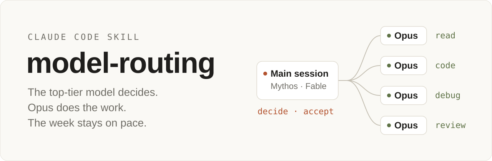
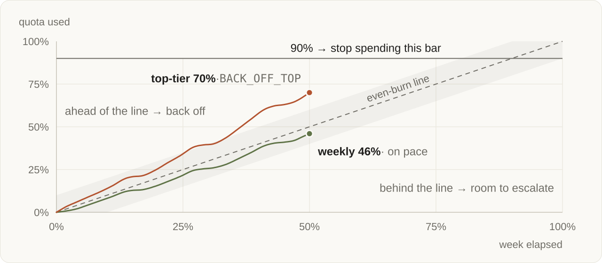
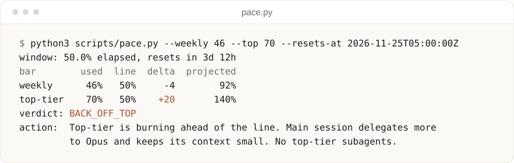

<div align="center">

<picture>
  <source media="(prefers-color-scheme: dark)" srcset="assets/hero-dark.svg">
  
</picture>

<br>

[](LICENSE)


[English](README.md) · **简体中文**

**顶配模型做决定,Opus 干活,一周的额度匀速用完。**

</div>

## 为什么

在 Claude 订阅里,Mythos 5.2 和 Fable 5.2 吃额度比 Opus 5.5 快得多。

| | Mythos / Fable 5.2 | Opus 5.5 | 倍数 |
|:--|:-:|:-:|:-:|
| 输入 / 输出标价(每百万 token) | $8 / $40 | $4 / $20 | 2× |
| 缓存读标价 | $0.20 | $0.20 | 1× |
| 每 1 美元标价吃掉的额度 | | | 约 2.5× |
| **Claude Code 这种缓存读占大头的用法,每个 token** | | | **约 4×** |

顶配模型还最多只能用周额度的一半。一周只用它,另一半额度就白扔了。

所以顶配模型只做非它不可的那部分,其余全交给 Opus。

## 怎么分工

| | 模型 | 负责 |
|:--|:--|:--|
| **主会话** | Mythos 或 Fable | 拆任务、定方案、验收结果、跟你对话 |
| **子 agent 和 workflow agent** | Opus 5.5 | 读文件、搜索、抓网页、写代码、调试、审查、起草 |

- **每次起 agent 都写明模型。** 不写就会继承主会话的模型。
- **主会话少读东西。** 它每一轮都要按顶配价格重读整个上下文,所以扫文件、长文档、日志都交给 Opus。
- **先 Opus,后顶配。** Opus 的结果没过验收,才用顶配重做那一块。
- **只有两档。** Sonnet 和 Haiku 省不了多少额度,还要赔上质量。

## 配速检查

起多个 agent 之前,skill 会把每条额度和匀速线比一下:已用百分比对本周已过百分比。

<picture>
  <source media="(prefers-color-scheme: dark)" srcset="assets/pace-dark.svg">
  
</picture>

高出匀速线 10 个点以上就收一收,低于 10 个点以上说明有富余可以升档。脚本把这些归成一个结论:

<picture>
  <source media="(prefers-color-scheme: dark)" srcset="assets/terminal-dark.svg">
  
</picture>

| 结论 | 什么时候 | Claude 怎么做 |
|:--|:--|:--|
| `HOLD` | 两条都在容差内 | 照常分工 |
| `ROOM_TOP` | 顶配条落后于匀速线 | 难的子任务可以交给顶配子 agent |
| `USE_IT` | 离重置不到一天,顶配额度还有剩 | 放开升档,不用就过期了 |
| `BACK_OFF_TOP` | 顶配条超前 | 多下放,不开顶配子 agent |
| `BACK_OFF_ALL` | 周条超前 | 少开 agent,机械活降 effort |
| `SESSION_FULL` | 5 小时窗口用到 85% 以上 | 等重置再开新一批 agent |
| `MINIMUM` | 周条用到 90% 以上 | 只做被要求的 |
| `SWITCH_MAIN` | 顶配条用到 90% 以上 | 建议把主会话切到 Opus |

## 安装

```bash
git clone https://github.com/Justaboringname/claude-code-model-routing ~/.claude/skills/model-routing
```

开一个新的 Claude Code 会话即可。任务要起子 agent,或者你问到模型分工、额度配速时,skill 会自动加载。

想让它对每个任务都生效,在 `~/.claude/CLAUDE.md` 里加一行:

```markdown
起子 agent 或 workflow 之前,先按 `model-routing` skill 查配速、定模型。
```

## 单独跑脚本

```bash
python3 ~/.claude/skills/model-routing/scripts/pace.py --weekly 46 --top 70 --resets-at 2026-11-25T05:00:00Z
```

`--weekly` 填 `/usage` 里的全模型周条,`--top` 填 Fable 条。

| 参数 | 用途 |
|:--|:--|
| `--session`、`--session-resets-at` | 有 5 小时窗口的套餐 |
| `--margin` | 偏离匀速线多少个点才改结论(默认 10) |
| `--json` | 输出 JSON |

需要 Python 3.8 以上,只用标准库。

## 数字从哪来

2.5 倍和 4 倍来自一个账号 2026 年 11 月的用量日志。Anthropic 没有公布过这两个数,请当作估算。标价来自 Anthropic 的定价页。

## License

[MIT](LICENSE)
